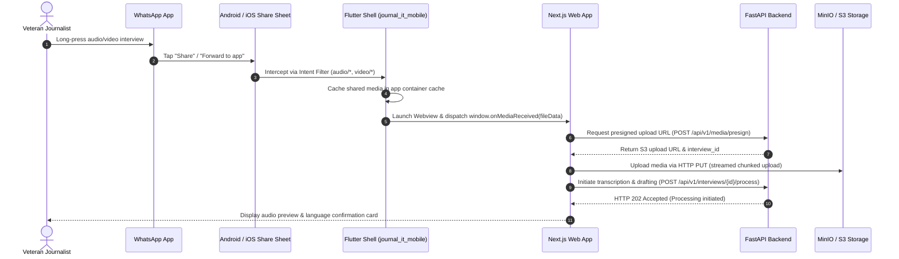

# Architectural Blueprint: Journal it

---

## 1. System Topology & Service Boundaries

Journal it adopts a **Modular Monolith** backend pattern paired with an asynchronous worker cluster and a decoupled Next.js frontend wrapped in a native Flutter shell.

```
[ Mobile / Desktop User ]
         │
         ├─── (1) WhatsApp Forward / Direct Upload
         ▼
[ Flutter Shell / PWA ] ──── (2) Presigned Upload ────► [ MinIO / S3 Storage ]
         │                                                      │
         ├─── (3) Trigger Processing Request                    │
         ▼                                                      │
[ FastAPI Gateway (Nginx) ] ── (4) Enqueue Task ──► [ Redis 7 ] │
                                                          │     │
                                                          ▼     ▼
                                                [ Celery Worker Pool ]
                                                          │
                                         (5) Direct Stream / File API
                                                          ▼
                                            [ Google Gemini API Engine ]
                                                          │
                                         (6) Diarize & Draft News Article
                                                          ▼
                                                [ PostgreSQL 16 DB ]
```

### Component Roles
1. **Next.js 14 Frontend:** Serves the accessible editorial user interface. Built with React Server Components, Tailwind CSS, Lucide icons, and bilingual RTL/LTR engines.
2. **Flutter Mobile Wrapper:** Embeds the web app via `flutter_inappwebview`, capturing native OS Share Sheets (specifically from WhatsApp) and passing file streams or URI pointers directly into the web application via a bi-directional JavaScript bridge.
3. **FastAPI Modular Monolith:** Handles authentication, presigned media upload URLs, article persistence, export generation, and user settings.
4. **Celery Worker Cluster:** Offloads heavy, non-blocking media streaming, communication with Google Gemini File API, and text synthesis.
5. **PostgreSQL 16:** Relational persistence with enforced Row-Level Security (RLS) guaranteeing tenant data isolation.
6. **MinIO / AWS S3:** Temporary staging storage for audio/video media and generated `.docx` deliverables with automatic 48-hour expiration lifecycle rules.

---

## 2. Ingestion Pipeline & WhatsApp Share Architecture

Senior journalists frequently receive voice notes, recorded phone interviews, and video footage over **WhatsApp**. Traditional web apps require journalists to download the file to their phone gallery, open a browser, find the website, and upload the file—a process with high cognitive friction. 

Journal it eliminates this friction through a **3-tier intake model**:



### Platform-Specific Implementations

#### A. Flutter Native Intent Receiver (Android & iOS)
In `apps/mobile_flutter/lib/main.dart`, the `receive_sharing_intent` plugin listens for media shared from external apps:
```dart
ReceiveSharingIntent.instance.getMediaStream().listen((List<SharedMediaFile> value) {
  if (value.isNotEmpty) {
    _handleIncomingMedia(value.first.path, value.first.type);
  }
});
```

#### B. PWA Web Share Target API (Browser Direct)
In `apps/web/public/manifest.json`:
```json
{
  "name": "Journal it",
  "short_name": "JournalIt",
  "start_url": "/",
  "display": "standalone",
  "share_target": {
    "action": "/share-target",
    "method": "POST",
    "enctype": "multipart/form-data",
    "params": {
      "title": "title",
      "text": "text",
      "files": [
        {
          "name": "media",
          "accept": ["audio/*", "video/*", ".mp3", ".m4a", ".wav", ".mp4", ".mov"]
        }
      ]
    }
  }
}
```

---

## 3. Gemini Multimodal Audio/Video Processing Engine

Journal it leverages the **Google Gemini 2.0 Flash / 1.5 Pro** multimodal architecture. Unlike legacy speech-to-text engines (which produce raw, unformatted transcripts that require a secondary LLM call), Gemini's native audio understanding enables direct interview comprehension, tone evaluation, speaker separation, and inverted-pyramid journalistic restructuring in a unified execution graph.

### Two-Stage Pipeline

```
[ Raw Audio/Video (S3) ]
           │
           ▼
[ Upload to Gemini File API (client.files.upload) ]
           │
           ├─── Stage 1: Verbatim Diarization & Timestamping
           ▼
[ Structured Transcript JSON (Speakers, Timestamps, Quotations) ]
           │
           ├─── Stage 2: Inverted-Pyramid Journalistic Synthesis
           ▼
[ Publication-Ready Newspaper Report (Headline, Lead, Nut Graph, Quotes) ]
```

### Prompt Architecture for Journalistic Report Generation

#### 1. System Prompt
```text
You are an award-winning senior investigative news editor. 
Your role is to analyze raw audio/video interviews and produce an objective, high-impact broadsheet newspaper report following standard journalism ethics (Associated Press Stylebook for English, or Arab News Agency / Al-Ahram standard for Arabic).

CRITICAL CONSTRAINTS:
1. Strict Factuality: Report ONLY facts, figures, and assertions made within the recording. Never invent external background facts unless verifiable from context.
2. Verbatim Quotes: Any quote enclosed in quotation marks must be an exact word-for-word quote from the speaker, attributed with the speaker's name or title.
3. Inverted Pyramid Structure:
   - Headline: Active voice, present tense, compelling, 6-10 words.
   - Subhead (Deck): Secondary context explaining the core significance.
   - Dateline & Byline: Professional journalistic standard.
   - Lead Paragraph: Who, what, when, where, and why in 35 words or fewer.
   - Nut Graph: The broader significance and impact of the interview.
   - Body & Key Quotes: Highlighting central tension, policy decisions, or revelations.
   - Context & Conclusion: Forward-looking statements and next steps.
```

#### 2. Dynamic Language & Cultural Adaptation Prompt
- **English Output:** Adheres strictly to AP Style guidelines, inverted pyramid syntax, neutral third-person voice, and punchy lead sentences.
- **Arabic Output:** Adheres to classical journalistic Arabic (لغة الصحافة العربية الفصحى الرصينة), using appropriate journalistic transitions (صرّح، وأكد، وأوضح، واختتم بالقول), avoiding colloquial dialect in the narrative while preserving verbatim dialect only in direct speaker quotes when vital.

---

## 4. Multi-Channel Export Subsystem

Journalists must deliver their copy to various news desks, CMS tools, or editorial WhatsApp groups immediately. Journal it provides 4 distribution mechanisms:

### 1. One-Click Clipboard Copy
Formats the article into clean, Markdown-formatted text with clear section headers, copying directly to the system clipboard with an oversized visual toast.

### 2. Native Mobile Share Sheet
Invokes the native OS share sheet using the Web Share API in browsers (`navigator.share()`) or Flutter's `share_plus` plugin in the mobile shell, allowing the journalist to send the text directly to another WhatsApp contact, Telegram, Signal, or Email.

### 3. Microsoft Word (.docx) Generation
Generates a downloadable `.docx` file styled as an authentic editorial proof:
- Newspaper masthead header with double horizontal ink rules.
- Headline in 24pt Georgia Bold with 14pt italicized deck.
- Dateline in uppercase small-caps bold.
- Body text in 11.5pt Georgia with 1.25 line spacing.
- Pull-quotes formatted with left border accents in crimson (`#8B0000`).

### 4. Direct Google Docs Integration
Journal it connects to the user's Google Account via OAuth2 (restricted to `https://www.googleapis.com/auth/documents` and `drive.file` scopes).
- Invokes `documents.create` via Google Docs REST API.
- Applies structured batch updates (`batchUpdate`) injecting titles, headings, lead paragraphs, and blockquotes with appropriate Google Docs structural formatting.
- Returns a direct `https://docs.google.com/document/d/{documentId}/edit` link that opens seamlessly on mobile or desktop.

---

## 5. Reverse Proxy, Caching & Load Balancing

```nginx
# /etc/nginx/conf.d/journal_it.conf
upstream fastapi_app {
    server api:8000 max_fails=3 fail_timeout=10s;
    keepalive 32;
}

upstream nextjs_app {
    server web:3000 max_fails=3 fail_timeout=10s;
    keepalive 32;
}

server {
    listen 80;
    server_name journalit.msoms.ai;
    return 301 https://$host$request_uri;
}

server {
    listen 443 ssl http2;
    server_name journalit.msoms.ai;

    ssl_certificate /etc/letsencrypt/live/journalit.msoms.ai/fullchain.pem;
    ssl_certificate_key /etc/letsencrypt/live/journalit.msoms.ai/privkey.pem;
    ssl_protocols TLSv1.2 TLSv1.3;
    ssl_ciphers HIGH:!aNULL:!MD5;

    client_max_body_size 2048M; # Support up to 2GB high-definition video files
    client_body_timeout 300s;

    # Gzip & Brotli compression for rapid mobile asset delivery
    gzip on;
    gzip_types text/plain text/css application/json application/javascript text/xml;

    location /api/ {
        proxy_pass http://fastapi_app;
        proxy_set_header Host $host;
        proxy_set_header X-Real-IP $remote_addr;
        proxy_set_header X-Forwarded-For $proxy_add_x_forwarded_for;
        proxy_set_header X-Forwarded-Proto $scheme;
        proxy_read_timeout 600s;
        proxy_connect_timeout 60s;
    }

    location / {
        proxy_pass http://nextjs_app;
        proxy_set_header Host $host;
        proxy_set_header X-Real-IP $remote_addr;
        proxy_set_header X-Forwarded-For $proxy_add_x_forwarded_for;
        proxy_set_header X-Forwarded-Proto $scheme;
    }
}
```
