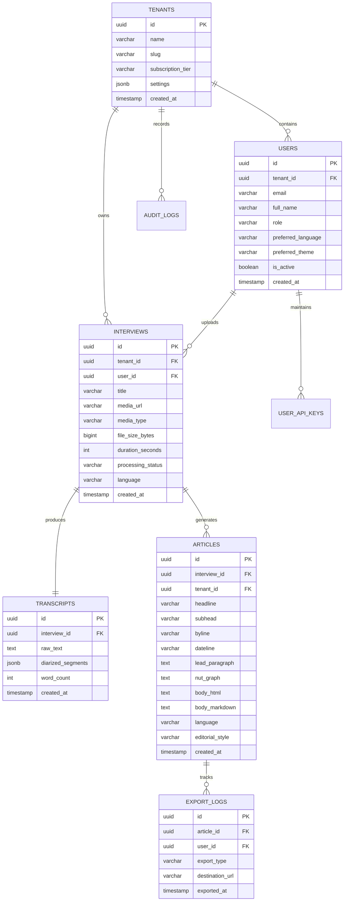

# Database Schema & Entity Relationships

---

## 1. Entity Relationship Diagram (ERD)



---

## 2. PostgreSQL DDL Specification (Production-Grade)

```sql
-- Enable UUID extension
CREATE EXTENSION IF NOT EXISTS "uuid-ossp";
CREATE EXTENSION IF NOT EXISTS "pgcrypto";

-- 1. Tenants Table
CREATE TABLE tenants (
    id UUID PRIMARY KEY DEFAULT gen_random_uuid(),
    name VARCHAR(255) NOT NULL,
    slug VARCHAR(100) UNIQUE NOT NULL,
    subscription_tier VARCHAR(50) NOT NULL DEFAULT 'solo_reporter',
    settings JSONB NOT NULL DEFAULT '{"max_audio_minutes": 300, "byok_enabled": true}'::jsonb,
    created_at TIMESTAMPTZ NOT NULL DEFAULT CURRENT_TIMESTAMP,
    updated_at TIMESTAMPTZ NOT NULL DEFAULT CURRENT_TIMESTAMP
);

-- 2. Users Table
CREATE TABLE users (
    id UUID PRIMARY KEY DEFAULT gen_random_uuid(),
    tenant_id UUID NOT NULL REFERENCES tenants(id) ON DELETE CASCADE,
    email VARCHAR(255) UNIQUE NOT NULL,
    hashed_password VARCHAR(255) NOT NULL,
    full_name VARCHAR(255) NOT NULL,
    role VARCHAR(50) NOT NULL DEFAULT 'senior_reporter',
    preferred_language VARCHAR(10) NOT NULL DEFAULT 'ar',
    preferred_theme VARCHAR(20) NOT NULL DEFAULT 'system', -- 'light', 'dark', 'system'
    is_active BOOLEAN NOT NULL DEFAULT true,
    created_at TIMESTAMPTZ NOT NULL DEFAULT CURRENT_TIMESTAMP,
    updated_at TIMESTAMPTZ NOT NULL DEFAULT CURRENT_TIMESTAMP
);
CREATE INDEX idx_users_tenant_id ON users(tenant_id);

-- 3. User & Tenant API Keys (Encrypted BYOK)
CREATE TABLE user_api_keys (
    id UUID PRIMARY KEY DEFAULT gen_random_uuid(),
    user_id UUID NOT NULL REFERENCES users(id) ON DELETE CASCADE,
    tenant_id UUID NOT NULL REFERENCES tenants(id) ON DELETE CASCADE,
    provider VARCHAR(50) NOT NULL DEFAULT 'gemini',
    encrypted_key TEXT NOT NULL,
    key_preview VARCHAR(20) NOT NULL, -- e.g. "AIzaSy...4xK9"
    is_active BOOLEAN NOT NULL DEFAULT true,
    created_at TIMESTAMPTZ NOT NULL DEFAULT CURRENT_TIMESTAMP
);
CREATE INDEX idx_api_keys_user ON user_api_keys(user_id);

-- 4. Interviews Table
CREATE TABLE interviews (
    id UUID PRIMARY KEY DEFAULT gen_random_uuid(),
    tenant_id UUID NOT NULL REFERENCES tenants(id) ON DELETE CASCADE,
    user_id UUID NOT NULL REFERENCES users(id) ON DELETE RESTRICT,
    title VARCHAR(500) NOT NULL,
    media_url VARCHAR(1024) NOT NULL,
    media_type VARCHAR(100) NOT NULL, -- e.g. "audio/mpeg", "video/mp4"
    file_size_bytes BIGINT NOT NULL,
    duration_seconds INT NULL,
    processing_status VARCHAR(50) NOT NULL DEFAULT 'uploaded', -- 'uploaded', 'transcribing', 'synthesizing', 'completed', 'failed'
    language VARCHAR(10) NOT NULL DEFAULT 'ar', -- 'ar' or 'en'
    error_message TEXT NULL,
    created_at TIMESTAMPTZ NOT NULL DEFAULT CURRENT_TIMESTAMP,
    updated_at TIMESTAMPTZ NOT NULL DEFAULT CURRENT_TIMESTAMP
);
CREATE INDEX idx_interviews_tenant ON interviews(tenant_id);
CREATE INDEX idx_interviews_status ON interviews(processing_status);

-- 5. Transcripts Table
CREATE TABLE transcripts (
    id UUID PRIMARY KEY DEFAULT gen_random_uuid(),
    interview_id UUID UNIQUE NOT NULL REFERENCES interviews(id) ON DELETE CASCADE,
    raw_text TEXT NOT NULL,
    diarized_segments JSONB NOT NULL DEFAULT '[]'::jsonb, -- Array of {speaker, timestamp, text}
    word_count INT NOT NULL DEFAULT 0,
    created_at TIMESTAMPTZ NOT NULL DEFAULT CURRENT_TIMESTAMP
);
CREATE INDEX idx_transcripts_interview ON transcripts(interview_id);

-- 6. Articles Table (Generated News Reports)
CREATE TABLE articles (
    id UUID PRIMARY KEY DEFAULT gen_random_uuid(),
    interview_id UUID NOT NULL REFERENCES interviews(id) ON DELETE CASCADE,
    tenant_id UUID NOT NULL REFERENCES tenants(id) ON DELETE CASCADE,
    headline VARCHAR(500) NOT NULL,
    subhead VARCHAR(1000) NULL,
    byline VARCHAR(255) NOT NULL,
    dateline VARCHAR(255) NOT NULL,
    lead_paragraph TEXT NOT NULL,
    nut_graph TEXT NOT NULL,
    body_markdown TEXT NOT NULL,
    body_html TEXT NOT NULL,
    language VARCHAR(10) NOT NULL DEFAULT 'ar',
    editorial_style VARCHAR(50) NOT NULL DEFAULT 'inverted_pyramid',
    created_at TIMESTAMPTZ NOT NULL DEFAULT CURRENT_TIMESTAMP,
    updated_at TIMESTAMPTZ NOT NULL DEFAULT CURRENT_TIMESTAMP
);
CREATE INDEX idx_articles_interview ON articles(interview_id);
CREATE INDEX idx_articles_tenant ON articles(tenant_id);

-- 7. Export Logs Table
CREATE TABLE export_logs (
    id UUID PRIMARY KEY DEFAULT gen_random_uuid(),
    article_id UUID NOT NULL REFERENCES articles(id) ON DELETE CASCADE,
    user_id UUID NOT NULL REFERENCES users(id) ON DELETE RESTRICT,
    export_type VARCHAR(50) NOT NULL, -- 'clipboard', 'native_share', 'docx', 'google_docs'
    destination_url VARCHAR(1024) NULL,
    exported_at TIMESTAMPTZ NOT NULL DEFAULT CURRENT_TIMESTAMP
);
CREATE INDEX idx_exports_article ON export_logs(article_id);

-- Triggers for updated_at
CREATE OR REPLACE FUNCTION update_updated_at_column()
RETURNS TRIGGER AS $$
BEGIN
    NEW.updated_at = CURRENT_TIMESTAMP;
    RETURN NEW;
END;
$$ language 'plpgsql';

CREATE TRIGGER trg_tenants_updated BEFORE UPDATE ON tenants FOR EACH ROW EXECUTE PROCEDURE update_updated_at_column();
CREATE TRIGGER trg_users_updated BEFORE UPDATE ON users FOR EACH ROW EXECUTE PROCEDURE update_updated_at_column();
CREATE TRIGGER trg_interviews_updated BEFORE UPDATE ON interviews FOR EACH ROW EXECUTE PROCEDURE update_updated_at_column();
CREATE TRIGGER trg_articles_updated BEFORE UPDATE ON articles FOR EACH ROW EXECUTE PROCEDURE update_updated_at_column();
```
