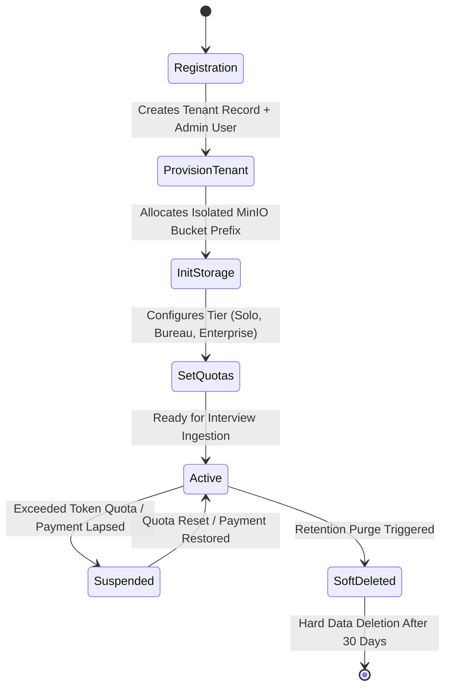

# Multi-Tenancy & Data Segregation Architecture

---

## 1. Multi-Tenancy Strategy

Journal it serves two primary operational models:
1. **Independent Journalists / Freelance Reporters:** Individual users with isolated personal storage, custom API keys, and private interview archives.
2. **Newsroom Bureaus & Editorial Desks (Tenants):** Multiple journalists, field reporters, and editors collaborating under a shared newsroom account (e.g., Al-Ahram Bureau, Reuters Cairo Desk) with shared quotas, shared reporting templates, and hierarchical editorial approvals.

To guarantee zero data leakage between independent reporters and competing news organizations, Journal it employs **PostgreSQL Row-Level Security (RLS)** using tenant discriminator columns (`tenant_id`) enforced at the database kernel level.

---

## 2. Row-Level Security (RLS) Architecture

Every database query executes within a PostgreSQL transaction where the active tenant and user identity are set in session-local variables:
```sql
SET LOCAL app.current_tenant_id = '018f3a21-9e2c-7b2a-89a1-432d6c123456';
SET LOCAL app.current_user_id   = '018f3a21-9e2c-7b2a-89a1-654d6c987654';
```

### PostgreSQL RLS Policies
```sql
-- Enable RLS on core tables
ALTER TABLE interviews ENABLE ROW LEVEL SECURITY;
ALTER TABLE transcripts ENABLE ROW LEVEL SECURITY;
ALTER TABLE articles ENABLE ROW LEVEL SECURITY;

-- Tenant Isolation Policy for Interviews
CREATE POLICY tenant_isolation_interviews ON interviews
    FOR ALL
    USING (
        tenant_id = NULLIF(current_setting('app.current_tenant_id', true), '')::UUID
    )
    WITH CHECK (
        tenant_id = NULLIF(current_setting('app.current_tenant_id', true), '')::UUID
    );

-- Tenant Isolation Policy for Articles
CREATE POLICY tenant_isolation_articles ON articles
    FOR ALL
    USING (
        tenant_id = NULLIF(current_setting('app.current_tenant_id', true), '')::UUID
    )
    WITH CHECK (
        tenant_id = NULLIF(current_setting('app.current_tenant_id', true), '')::UUID
    );
```

---

## 3. Tenant Onboarding & Provisioning Lifecycle



### Subscription Tiers & Quota Limits

| Tier Name | Target User | Monthly Audio/Video Minutes | Max File Size | Gemini BYOK Allowed | Google Docs Sync |
| :--- | :--- | :--- | :--- | :--- | :--- |
| **Solo Reporter** | Freelance Journalist | 300 minutes / month | 250 MB | Yes (Unlimited) | Yes |
| **Newsroom Desk** | Regional Bureau (up to 10 reporters) | 3,000 minutes / month | 1 GB | Yes | Yes (Team Shared Drive) |
| **Enterprise Agency** | National News Agency | 25,000 minutes / month | 2 GB | Yes + Dedicated Pool | Yes + Custom Webhook |

---

## 4. Cross-Tenant Leakage Verification Test Suite

Automated tests in `apps/api/tests/test_rls.py` verify that tenant data is strictly unreachable across organizational boundaries, even under simulated SQL injection or compromised session states.

```python
import pytest
from uuid import uuid4
from sqlalchemy.orm import Session
from src.models import Tenant, User, Interview

def test_cross_tenant_isolation_enforcement(db_session: Session):
    # Setup Tenant A and Tenant B
    tenant_a = Tenant(id=uuid4(), name="Bureau Al-Ahram")
    tenant_b = Tenant(id=uuid4(), name="Bureau Reuters")
    db_session.add_all([tenant_a, tenant_b])
    db_session.commit()

    # Create Interview under Tenant A
    interview_a = Interview(
        id=uuid4(),
        tenant_id=tenant_a.id,
        title="Minister of Energy Interview",
        status="completed"
    )
    db_session.add(interview_a)
    db_session.commit()

    # Simulate Request authenticated as Tenant B
    db_session.execute(f"SET LOCAL app.current_tenant_id = '{tenant_b.id}'")
    
    # Query all interviews as Tenant B
    results = db_session.query(Interview).all()
    
    # Assert Tenant B cannot see Tenant A's interview
    assert len(results) == 0, "Security Violation: Cross-tenant data leakage detected!"
```
