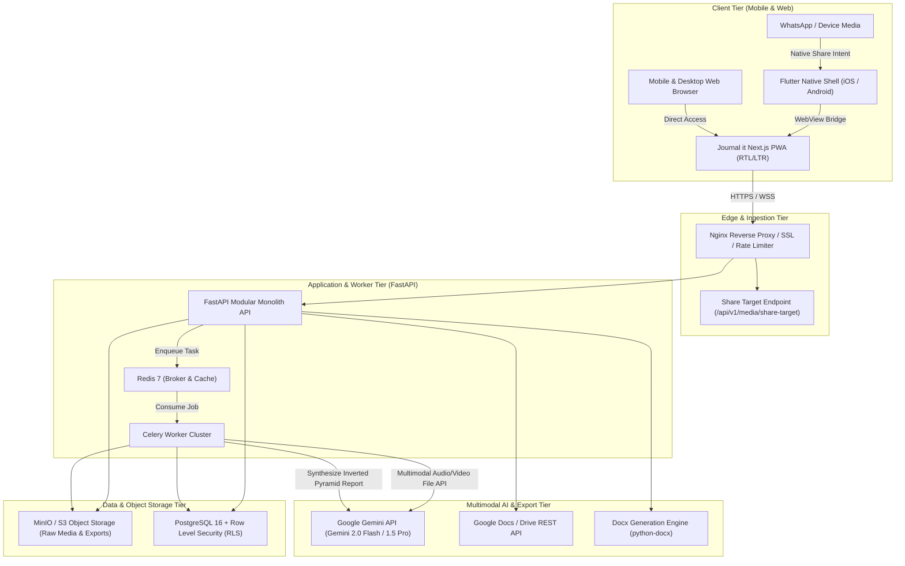

# Journal it (جورنال إت) — Production Specification Suite

> **AI-Powered Mobile & Web Investigative Journalism Studio for Voice & Video Interviews**  
> **Built for msoms.ai | Engineered for Senior Journalists & News Desks**

---

## 1. Project Overview & Mission Statement

**Journal it** (**جورنال إت**) is a modern editorial workflow platform engineered to transform raw, unstructured audio and video interview recordings into publication-ready, professional newspaper articles in minutes. 

While cutting-edge artificial intelligence underpins its processing engine, **Journal it** is explicitly designed for **veteran and senior journalists** who value speed, simplicity, and journalistic integrity over complex technical controls. The application marries the timeless aesthetic of print journalism (broadsheet typography, high-contrast ink-on-paper palette, physical affordances) with modern multimodal AI capabilities powered by the Google Gemini API.

### Core Objectives
1. **Frictionless Ingestion:** Accept interview audio and video recordings directly from file uploads, direct mobile share sheets, or WhatsApp forwarding.
2. **Senior-Accessible UI/UX:** Tactile, uncluttered interface featuring 56px touch targets, high-contrast broadsheet aesthetics, generous font scaling, and zero multi-step confusion.
3. **Bilingual Journalistic Precision:** Native dual-engine support for **Arabic** (RTL, Arab News Agency / Al-Ahram inverted-pyramid style) and **English** (LTR, AP / Reuters editorial standard).
4. **Instant Multi-Channel Distribution:** One-click clipboard copy, native mobile app sharing, downloadable formatted Microsoft Word (`.docx`) documents, and direct export to Google Docs.
5. **Mobile-First & App-Ready:** Responsive web application optimized for zero-overhead wrapping into native iOS and Android applications via Flutter WebView.

---

## 2. System Architecture Diagram



---

## 3. Core Features & Capabilities Matrix

| Feature Domain | Capability | Description |
| :--- | :--- | :--- |
| **Media Intake** | Audio & Video Support | Ingests `.mp3`, `.m4a`, `.wav`, `.aac`, `.mp4`, `.mov`, `.mkv`, and `.webm` up to 2GB. |
| **WhatsApp Intake** | One-Tap Share Receiver | Receives forwarded voice notes and interview videos directly from WhatsApp via Android/iOS share sheet. |
| **Bilingual Engine** | Arabic & English | Full RTL/LTR layout toggling; culture-aware editorial synthesis matching Egyptian/Gulf news agencies or AP/Reuters. |
| **Theme Engine** | Dark & Light Switcher | Tactile Morning Broadsheet (Ivory) and Night Press (Charcoal Obsidian) palettes with system auto-detection, local persistence, and WCAG AAA compliance. |
| **Accessibility** | Senior-Friendly UX | 18px-24px scalable typography, 56px minimum touch targets, high contrast (WCAG AAA), single-track flow. |
| **Gemini AI Core** | Multimodal Audio/Video | Uses Gemini File API for direct audio transcription, speaker separation, quote attribution, and article drafting. |
| **Article Structure** | Inverted Pyramid | Generates punchy headlines, subheads (decks), dateline, lead paragraph, direct verbatim quotes, and context. |
| **Export Formats** | Multi-Format Delivery | One-click copy, native mobile share sheet (`share_plus`), styled `.docx` broadsheet, and Google Docs creation. |
| **Deployment** | Flutter WebView Ready | Lightweight Flutter wrapper with JavaScript bridge for hardware permissions, intent filters, and secure storage. |

---

## 4. Repository Directory Structure

```text
journal-it/
├── .github/
│   └── workflows/              # CI/CD pipelines (lint, test, build, containerize)
├── apps/
│   ├── web/                    # Next.js 14 Frontend Application (App Router, Tailwind, Lucide)
│   │   ├── src/
│   │   │   ├── app/            # Routes: [locale]/(auth), (app)/editor, /share-target
│   │   │   ├── components/     # Accessible UI components (Broadsheet Masthead, AudioPlayer)
│   │   │   ├── hooks/          # useGeminiKey, useShareBridge, useSpeechFeedback
│   │   │   ├── lib/            # i18n configs (Amiri, Cairo, Playfair Display), API client
│   │   │   └── styles/         # High-contrast newsprint CSS variables
│   │   ├── public/             # Newspaper textures, manifest.json (Web Share Target)
│   │   └── package.json
│   ├── api/                    # FastAPI Backend Application (Python 3.11+)
│   │   ├── src/
│   │   │   ├── api/            # API v1 route controllers (auth, media, interviews, exports)
│   │   │   ├── core/           # Security, AES-256 key encryption, config settings
│   │   │   ├── models/         # SQLAlchemy 2.0 ORM models (Tenants, Users, Articles)
│   │   │   ├── schemas/        # Pydantic v2 validation contracts
│   │   │   ├── services/       # Gemini Service, Docx Service, Google Docs Service
│   │   │   └── workers/        # Celery background tasks for async multimodal processing
│   │   ├── tests/              # PyTest test suite (unit, integration, RLS validation)
│   │   └── requirements.txt
│   └── mobile_flutter/         # Flutter Mobile Wrapper Application
│       ├── android/            # AndroidManifest with Send Intent Filter (video/*, audio/*)
│       ├── ios/                # Info.plist & Share Extension configuration
│       ├── lib/
│       │   ├── bridge/         # JavaScript Object Bridge for InAppWebView
│       │   ├── screens/        # WebView container screen, offline fallback screen
│       │   └── main.dart       # App initialization, intent receiver setup
│       └── pubspec.yaml
├── docker/
│   ├── docker-compose.yml      # Local development stack (Web, API, Redis, Postgres, MinIO)
│   ├── Dockerfile.web
│   ├── Dockerfile.api
│   └── nginx.conf              # Reverse proxy configuration
├── packages/
│   └── shared-types/           # Shared TypeScript interfaces for API contracts
└── README.md
```

---

## 5. Quickstart Guide for AI Agents and Developers

### Prerequisites
- Docker Engine 24.0+ & Docker Compose v2+
- Node.js 20.x & pnpm 9.x
- Python 3.11+
- Flutter SDK 3.22+ (for mobile packaging)
- Google Gemini API Key (obtain from Google AI Studio)

### Step 1: Clone and Configure Environment
```bash
git clone https://github.com/msoms-ai/journal-it.git
cd journal-it
cp .env.example .env
```
Ensure `GEMINI_API_KEY` is configured in `.env` (or configured per-user in the app UI via BYOK mode).

### Step 2: Launch Development Stack
```bash
docker compose -f docker/docker-compose.yml up -d --build
```
Services available:
- **Web App (PWA):** `http://localhost:3000`
- **FastAPI Docs:** `http://localhost:8000/docs`
- **MinIO Console:** `http://localhost:9001` (Credentials: `minioadmin` / `minioadmin`)
- **Postgres DB:** `localhost:5432` (`journal_it` / `journal_secret`)

### Step 3: Run Flutter Mobile App (Android/iOS)
```bash
cd apps/mobile_flutter
flutter pub get
flutter run
```
